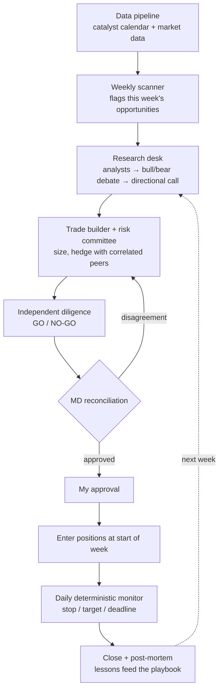

# Zamvar Capital — Fund 1

## What this is

Fund 1 is a series of agentic frameworks that automate equity trading around biotech catalysts: FDA approval decisions, clinical-trial readouts and other scheduled events that can move a stock sharply in a single day.

For each upcoming catalyst, the system:

1. **Takes in the expected catalyst date** for a company on its watchlist.
2. **Researches the event across several dimensions** (clinical, regulatory, financial and market sentiment) and turns that research into a directional call: will the stock go up or down?
3. **Builds a trade** from that call, sized to its risk and paired with correlated peer stocks to hedge it.
4. **Enters the position at the start of the week** and watches it with a deterministic monitor that checks it once a day and exits early if a stop, target or deadline is hit.

### The weekly flow

---

## Why I built it

At my internship at Parthenon I learned how to build agentic frameworks: breaking a hard problem into focused agents that each do one job, check each other's work and hand off structured results. I also saw that discovery, meaning finding the right information and pressure-testing it, is most of what firms are actually paying for. That made me want to test how much of an institutional research and discovery process I could replicate with a series of AI frameworks. I picked biotech catalysts because they're scheduled, binary events with fast, honest feedback: within a week you know whether the research was right.

---

## The segments

### 1. Data & catalyst discovery

Everything downstream depends on knowing *when* a catalyst is coming and *what* the market looks like around it, and institutional funds pay data vendors heavily for both. I built that layer from free public sources instead. FDA decision dates come straight from companies' own SEC 8-K filings, trial readout dates from ClinicalTrials.gov, and FDA advisory-committee meetings from the Federal Register. Financials come from SEC XBRL filings, short interest from FINRA, options data from CBOE, and macro conditions from FRED. Prices and earnings dates are pulled from several free feeds (Yahoo Finance, Nasdaq, Tiingo, Alpha Vantage, FMP) so they can be checked against each other. An always-on pipeline refreshes all of this on a schedule, cross-checks the important numbers across sources, and stamps every record with the date it actually became public, so a backtest never "knows" something before it happened. From that history the system picks its watchlist: the biotech names that have moved the most on past catalysts.

### 2. Research desk

Each catalyst is researched by four specialist analyst agents: clinical (trial design and data quality), regulatory (FDA precedent and review history), financial (cash runway, dilution, valuation) and market sentiment (short interest, options activity, positioning). Their reports go to a bull agent and a bear agent, who argue opposite sides over a fixed number of rounds in separate sessions, so neither can just echo the other. A moderator weighs the debate and makes a binary call, up or down, along with the specific conditions that would prove it wrong. A verifier then checks every claim against its source and drops anything it can't trace. The agents interpret; every number they use comes from tested, deterministic code.

### 3. Trade builder & risk

The builder turns a direction into a position. It estimates how far the stock is likely to move by looking at how similar past catalysts played out, and it can blend in the options market's implied move and valuation-based estimates when those inputs are available. A three-member risk committee (aggressive, conservative and neutral) argues the downside independently. Then a deterministic sizing step caps each bet so that no single event can do serious damage to the fund, while still targeting about 1% a week. Each trade is paired with a correlated or inverse peer stock to offset risk, since the broker only allows long positions.

### 4. Independent diligence

Real funds don't let the team that pitched a trade also approve it. A separate group of eight agents (trial statistics, regulatory, financials, ownership flows, options-implied move, hedge re-check, liquidity and historical analogs) gets only the raw facts, never the desk's conclusion. Each agent is told to find the reason the trade fails. Their findings feed a rule-based GO / NO-GO decision.

### 5. MD reconciliation & approval

When the desk and diligence disagree, a managing-director step compares their numbers side by side. Instead of picking a winner, it sends the trade back to the desk with the specific information that was missing, and the desk tries again. This repeats until the two sides converge or hit a round limit; anything still unresolved is escalated with its caveats written down. Nothing enters the portfolio without my explicit approval, which I give from an iPhone dashboard I built for the system.

### 6. Daily monitor & learning loop

Once a position is open, no AI is involved in managing it. A deterministic monitor checks it once a day against an exit plan set at entry: a stop-loss, a profit target and a hard deadline tied to the catalyst. After each event resolves, the system records what it predicted, what actually happened and why. Those records build a playbook of past catalysts and the signals that mattered, which the research desk reads before its next call. A judge agent scores past calls, and any proposed change to the system's settings must pass a regression test on historical data and get my sign-off before it goes live.

---

## What I learned

**Data is never easily obtainable.** I assumed the hard part would be the agents. It was the data. Institutional funds license clean, complete databases; I had to source everything myself from free public places:

- **SEC EDGAR**: company 8-K filings (for FDA decision dates) and XBRL financial statements
- **ClinicalTrials.gov**: trial timelines and readout dates
- **Federal Register**: FDA advisory-committee meetings
- **FINRA**: short interest
- **CBOE**: options prices and implied volatility
- **FRED**: interest rates and macro conditions
- **Yahoo Finance, Nasdaq, Tiingo, Alpha Vantage and FMP**: prices and earnings dates

None of these sources is complete or reliable on its own. Some go down, some disagree with each other, and the free tiers cap how often you can call them. So I built a pipeline that pulls from each one on a schedule and caches everything so nothing gets fetched twice. It cross-checks important numbers across sources before trusting them, and it records when each fact actually became public, so the history can't leak the future into a backtest. The biggest win was writing my own extractor that reads FDA decision dates straight out of company filings, which is information other people charge for. The result isn't comparable to an institutional database, but it's accurate, consistent and good enough to research and trade on.

**You can't trust a backtest of an AI model on events it already knows about.** The language models behind the agents were trained on the internet, which includes the news about how past FDA decisions and trial readouts turned out. When you ask an agent to "predict" a catalyst from two years ago, it may already know the answer, even if every piece of data you hand it is dated correctly. That hidden bias makes an agentic backtest look better than the system really is. I handled this in three ways. The historical backtest runs the deterministic parts of the strategy without letting a language model make the calls. Every agent only sees data that was public before the event. And the real test is forward paper trading on catalysts that haven't happened yet, which no model could have seen.
