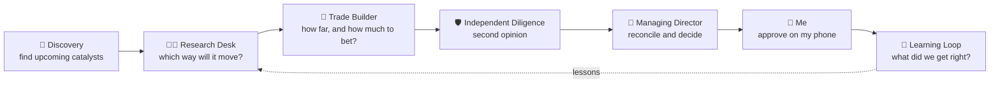
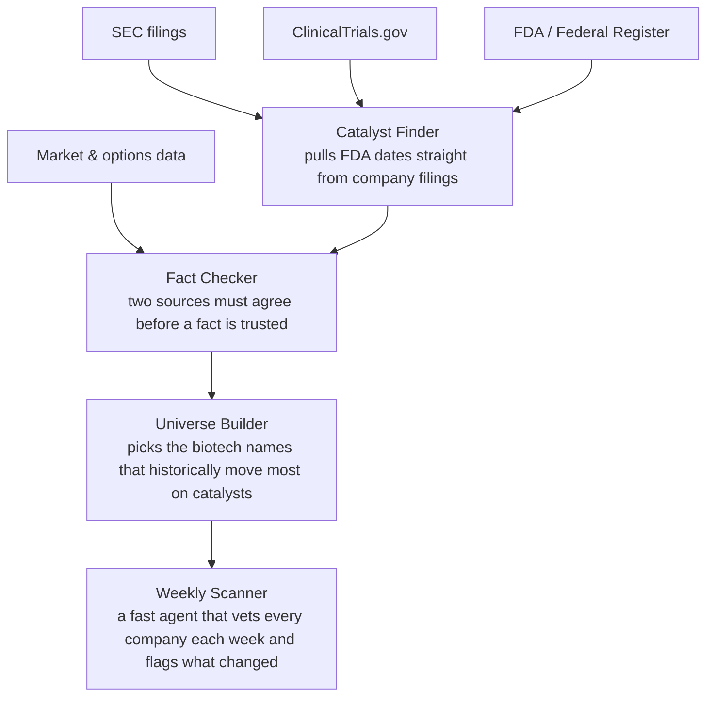
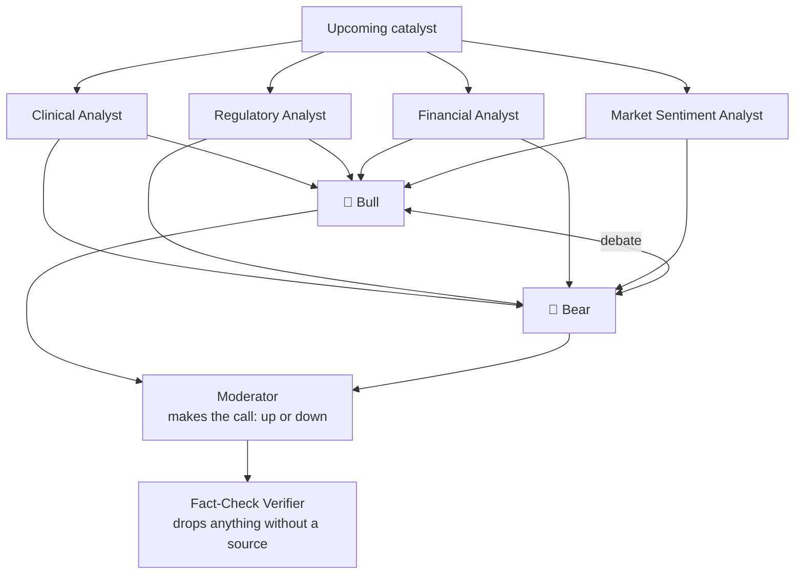
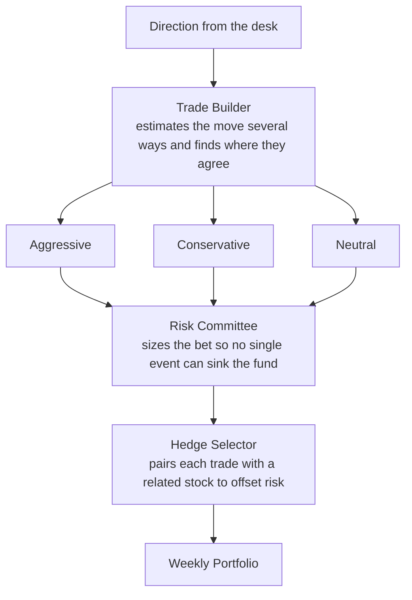
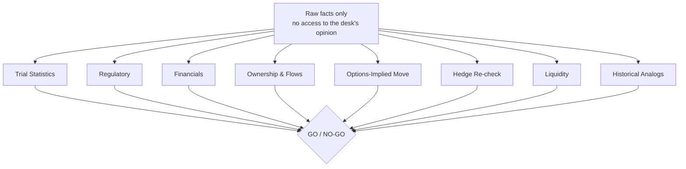
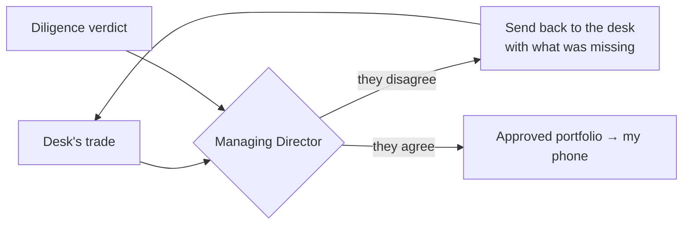
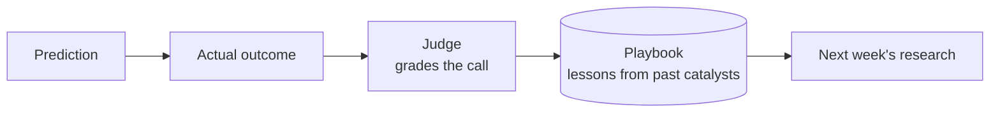

# Zamvar Capital — Fund 1

**A team of AI agents that researches, debates and trades biotech catalyst events, built to work the way an institutional research desk does.**

---

## Why I built this

During my internship at Parthenon I got deep into building agentic frameworks: chaining AI agents together so each one does a focused job, checks the others, and hands off structured work. I also learned something about the business itself. **Most of what firms are actually paying for is discovery.** Finding the right information, pressure-testing it, and turning it into a view you can act on is where the real hours, and the real value, go.

That made me curious. If discovery is the expensive part, how much of an institutional research and discovery process could I rebuild with a set of AI frameworks? I wanted a domain where the answer is graded quickly and honestly, so I picked **biotech catalysts**: FDA approval dates, clinical-trial readouts and earnings. These are scheduled, binary events where a stock can move 20–50% in a day, so whether the research was good shows up within a week.

Fund 1 is my attempt to replicate that desk: analysts, a debate, a portfolio builder, a risk committee, an independent diligence team and a managing director. Each role is played by AI agents, and every week the system learns from how its calls played out.

---

## The big picture

Each week the fund runs the same loop that a human event-driven fund would.

The system runs around the clock on a server at home. Data is collected continuously, the desk runs every week, and I review and approve the portfolio from an iPhone app I built for it.

---

## The agentic frameworks

### 1. Discovery: finding the events

Before anyone can research a trade, someone has to find it. This layer replaces what analysts normally pay data vendors for. It reads company filings, clinical-trial registries and government sources directly, so it can build its own calendar of upcoming catalysts.

| Agent | What it does |
|---|---|
| Catalyst Finder | Reads company filings and trial registries to find upcoming FDA decisions and trial readouts |
| Fact Checker | Only trusts a fact once two independent sources agree on it |
| Universe Builder | Chooses which companies to watch, based on how much they have historically moved on events |
| Weekly Scanner | A lightweight agent that sweeps every company each week and flags anything new |

---

### 2. The Research Desk: which way will it move?

This is the heart of the fund. Four specialist analysts each research one angle. Then two agents argue opposite sides, and a moderator makes the call. Every claim has to cite a source, or it gets thrown out.

| Agent | What it does |
|---|---|
| Clinical Analyst | Is the science good? Trial design, data quality, how similar drugs have done |
| Regulatory Analyst | What is the FDA likely to do? Precedent, advisory committees, review history |
| Financial Analyst | Can the company survive either outcome? Cash, dilution risk, valuation |
| Market Sentiment Analyst | What is already priced in? Short interest, options activity, positioning |
| Bull & Bear | Argue the strongest case for each side, using only the analysts' evidence |
| Moderator | Weighs the debate and calls a direction, plus what would prove the call wrong |
| Verifier | Checks every claim against its source and removes anything unsupported |

---

### 3. The Trade Builder & Risk Committee: how far, and how much?

Knowing the direction isn't enough. The builder estimates how big the move will be by looking at it from several angles at once: what the drug is worth, what the options market expects, what Wall Street analysts expect, and how similar past events played out. It goes with the number those angles agree on. A risk committee then decides how much to bet.

| Agent | What it does |
|---|---|
| Trade Builder | Estimates the size of the move using several independent methods |
| Risk Committee (3 voices) | An aggressive, a conservative and a neutral voice debate position size |
| Hedge Selector | Finds a related stock that offsets the trade's risk |
| Portfolio Builder | Assembles the week's trades, aiming for about 1% a week |

---

### 4. Independent Diligence: the second opinion

Real funds don't let the team that pitched a trade also sign off on it. This diligence team is **firewalled**: it never sees the desk's conclusion, only the raw facts. It has to reach its own answer, and it only gives a GO if that answer holds up.

Each of the eight agents is told to **find the reason this trade fails**, so the team works as a deliberate devil's advocate.

---

### 5. The Managing Director: reconciling disagreements

When the desk and the diligence team disagree, the MD doesn't just pick one. It sends the trade back to the desk with the specific information it was missing, and the desk tries again. This repeats until the two sides converge or the trade is dropped.

---

### 6. The Learning Loop: getting better every week

After every event the fund writes down what it predicted, what actually happened and why. Those lessons build up a **playbook**, a memory of past catalysts and the signs that mattered, which the research desk reads before its next call. A judge agent grades past calls, and changes only go live once they have proven themselves on history.

---

## Doing it the way a real fund would

I wanted this to hold up to the standards a real fund uses, not just look impressive:

- **No peeking at the future.** Every piece of data is stamped with the date it actually became available, so backtests only use what was known at the time.
- **Honest performance measurement.** Returns are compared against the biotech index (XBI), and the Sharpe ratio is adjusted for luck.
- **Realistic trading costs** are built into every simulated trade.
- **Agents interpret, code calculates.** Every number comes from tested, deterministic code. The AI agents never do the math themselves.
- **A human always has the final say.** Nothing trades without my approval.

---

## Built with

Python · Claude Agent SDK · SQLite knowledge graph with vector search · SwiftUI iOS app · FastAPI · free public data from the SEC, ClinicalTrials.gov, the FDA and FRED
